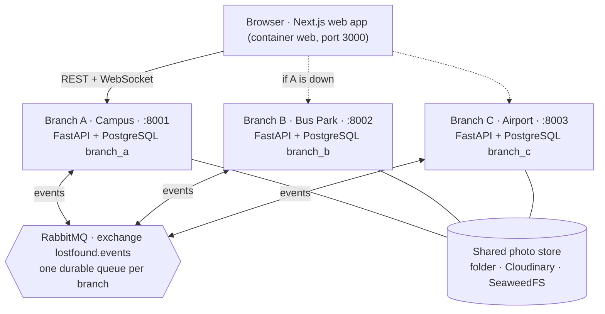
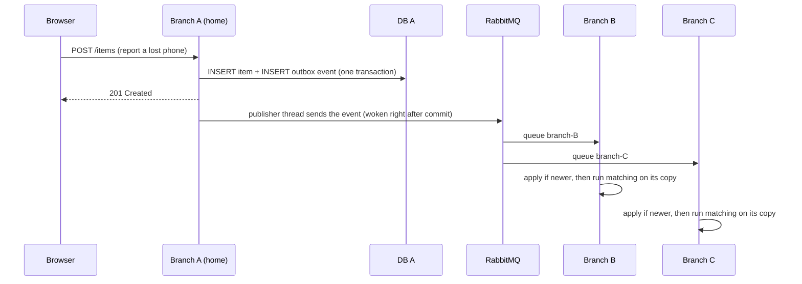
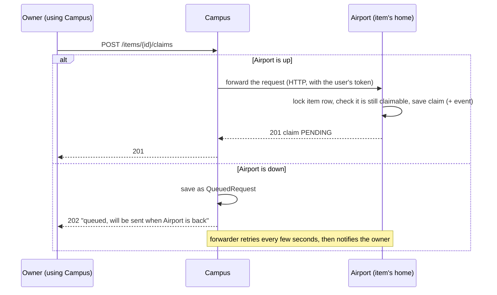

# Architecture

LostFinder is a **distributed lost-and-found system** for three branch offices: **Campus (A)**, **Bus Park (B)** and **Airport (C)**. Each branch is a separate server with its **own PostgreSQL database**. The branches keep full copies of each other's data by exchanging events through **RabbitMQ**, so any branch can serve any request, even when another branch or the broker is down.

Everything runs on one computer with Docker Compose. All the software is free and open source.

## Components



Besides the events, the branches also call each other directly over HTTP: **heartbeats** every 5 seconds, **claim forwarding** to an item's home branch, and **snapshots** for resync.

| Part | Technology | Role |
|---|---|---|
| Web app | Next.js 16, React 19, Tailwind CSS 4 | Pages, dashboards, charts; talks to one branch at a time and switches if it goes down |
| Branch server | Python 3.12, FastAPI, SQLAlchemy | The API; the same code runs three times with a different `BRANCH_ID` |
| Branch database | PostgreSQL 16 (one per branch) | Its own items plus full copies of the others' |
| Message broker | RabbitMQ 3 | Carries change events between branches; a durable queue per branch keeps events while a branch is offline |
| Photo store | Shared Docker volume, Cloudinary (free plan) or SeaweedFS | Photos are stored once, named by their SHA-256 hash |
| Live notifications | WebSockets | Pushes matches and claim decisions to the browser |

## Data and ownership

| Data | Created at | Changed at | Conflict rule |
|---|---|---|---|
| Item (lost or found report) | the branch where it was reported, its **home branch** | only its home branch (the *primary copy*) | higher `version` wins |
| Claim | the item's home branch | only the item's home branch | higher `version` wins |
| Match (possible pair) | computed by **every** branch independently | — | same deterministic id (UUID v5 of the two item ids), so all branches agree |
| User account | any branch (sign-up, or an admin) | any branch (admin, or the person) | higher `version` wins; same version: later `updated_at` wins |

Items and claims follow a **primary-copy** model: one branch decides, the others hold read-only copies. This is what makes claims safe. Two people claiming the same item at the same moment at different branches both end up at the home branch, which locks the item row (`SELECT … FOR UPDATE`) so that exactly one claim succeeds.

User accounts can be edited anywhere, because an admin or the person may be at any branch. They use **last-writer-wins on versions**: every change increments the version, and each branch keeps the copy with the highest version.

## How a change reaches every branch



* **Outbox pattern.** The change and its event are saved in the same database transaction, so a change is never saved without its event. If RabbitMQ is down, events wait in the outbox and are sent when it comes back.
* **Durable queues.** Each branch has its own queue, so a branch that is offline receives the events it missed when it restarts.
* **Idempotent apply.** Applying the same event twice changes nothing, and an older version never overwrites a newer one.
* **Measured lag:** median 9.1 ms from saving at one branch to being readable at the others (see [TESTING.md](TESTING.md)).

## Claims across branches



## Fault tolerance (Phase 5)

| Failure | Detection | What keeps working | Recovery |
|---|---|---|---|
| A branch crashes | heartbeats every 5 s; *down* after 3 misses | other branches accept reports, search everything, queue claims for the dead branch | on restart: durable queue + **anti-entropy resync** from peers' snapshots |
| RabbitMQ stops | publisher/consumer reconnect loop | every branch keeps working; events wait in the outbox | outbox drained when the broker returns |
| A database is wiped | — | — | resync rebuilds the branch's own items from the copies held by the others |
| The browser's branch goes down | 2 missed heartbeats in the web app | the app switches to another branch automatically | — |

Resync runs at start-up, whenever a peer comes back up, every 5 minutes, and on demand (`POST /replication/resync`).

## Security

* Passwords are stored as bcrypt hashes; the hash is replicated so a person can sign in at any branch.
* Sign-in returns a JWT signed with a secret shared by the branches; it works at every branch.
* Roles: **member** (report and claim), **staff** (decide claims for one branch), **admin** (everything, including user management).
* A **disabled** account can't sign in, and its tokens stop working at every branch as soon as the change replicates.
* Branch-to-branch calls (snapshots for resync) use a separate short-lived internal token.
* Secrets live only in `.env`, never in the code or in `docker-compose.yml`.
* Claims require answering the finder's question; staff check the answer before handing an item over.

## Code map

```
backend/app/
  main.py          start-up: create/upgrade tables, seed branches and admin, start background threads
  models.py        tables: users, items, claims, matches, outbox_events, queued_requests, branches
  replication.py   outbox, publisher and consumer threads, applying events (conflict rules)
  reliability.py   heartbeat monitor, queued-claim forwarder, snapshots and resync
  matching.py      scoring lost/found pairs and explaining the score
  notifier.py      WebSocket connections
  routers/         auth, users (admin), items, photos, claims, stats, live, replication, health
frontend/src/
  app/             one folder per page (dashboard, lost, found, report, matches, claims, admin/users…)
  components/      layout (sidebar, top bar), charts, cards, dialogs
  lib/             API client, sign-in state, notifications, theme, branch health/failover
```
